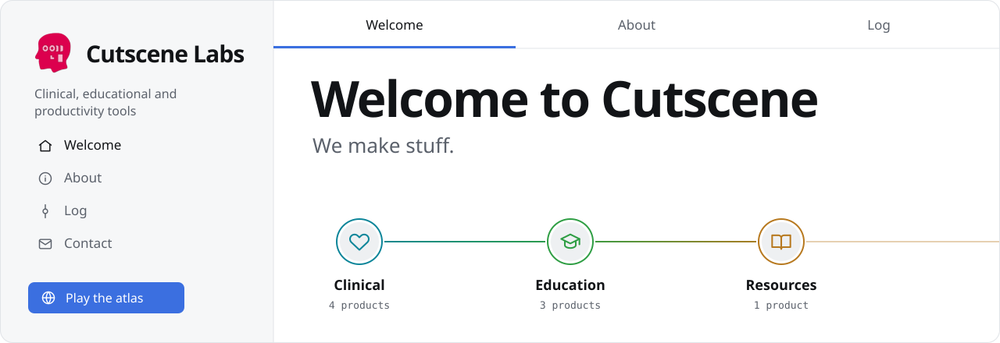
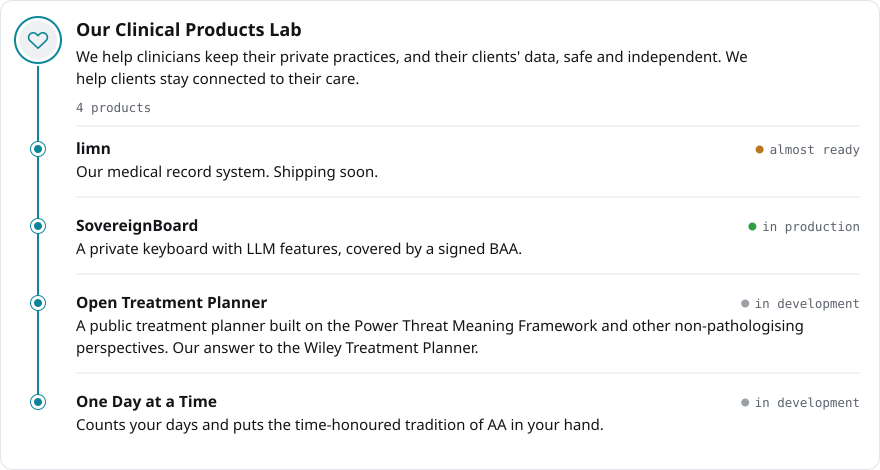
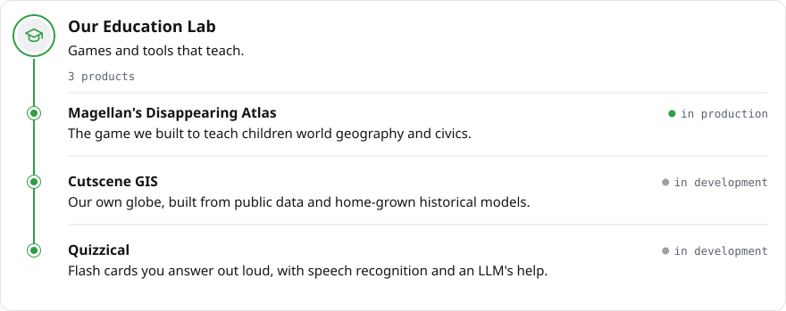
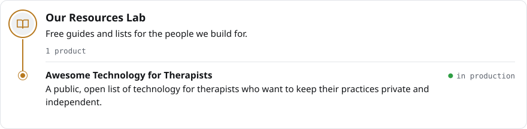

  <a href="https://cutscene.me"><code>cutscene.me</code></a> ·
  <a href="https://cutscene.me/about/"><code>about</code></a> ·
  <a href="https://cutscene.me/log/"><code>log</code></a> ·
  <a href="mailto:hey@cutscene.me"><code>hey@cutscene.me</code></a> ·
  <a href="https://magellan.cutscene.me"><code>play the atlas</code></a>

 

<code>on github</code> → <a href="https://github.com/Cutscene-Labs/sovereignboard">sovereignboard</a> · <a href="https://github.com/Cutscene-Labs/florisboard-tx">florisboard-tx</a> · <a href="mailto:hey@cutscene.me?subject=SovereignBoard%20invite">request a SovereignBoard invite</a>

  

<code>play</code> → <a href="https://magellan.cutscene.me">magellan.cutscene.me</a>

  

<code>on github</code> → <a href="https://github.com/Cutscene-Labs/awesome-technology-for-therapists">awesome-technology-for-therapists</a> · <a href="https://awesometech.jchackett.me">read the list</a>

  

<code>© Cutscene Labs · Amsterdam, NL · Registered in Maine, US</code>

